<div align="center">

<picture>
  <source media="(prefers-color-scheme: dark)" srcset=".github/assets/banner-dark.svg">
  
</picture>

**Laravel Octane lifecycle, powered by Rust and Tokio.**<br>
Connect PAM's native HTTP transport to Octane while Octane keeps ownership of Laravel isolation and worker lifecycle.

[](https://packagist.org/packages/pushinbr/pam-octane)

[](LICENSE)

[Install](#install) · [Commands](#quick-example) · [How it works](#how-it-works) · [Compatibility](#compatibility) · [Docs](#docs) · [Issues](https://github.com/push-in/pam-octane/issues)

</div>

<a id="install"></a>
## <picture></picture> Install

In a Laravel application on PAM:

```sh
pam init my-app --template laravel
cd my-app
pam composer require laravel/octane pushinbr/pam-octane
pam octane:start
```

The defaults are production-safe and require no configuration. PAM Octane requires the PAM runtime: running `php artisan pam:octane` reports a clear error because ordinary PHP CLI does not contain PAM's native server; use `pam artisan` or `pam octane:start`.

<a id="quick-example"></a>
## <picture></picture> Commands

```sh
pam octane:start     # start Laravel Octane on the PAM supervisor
pam octane:status    # inspect the PAM Octane application
pam octane:reload    # reload without downtime
pam octane:stop      # stop the application
```

`octane:start` runs `pam up artisan --name pam-octane ... -- pam:octane`; arguments before `--` go to the supervisor, arguments after it to the server.

<a id="how-it-works"></a>
## <picture></picture> How it works

PAM Octane connects PAM's native HTTP transport directly to Laravel Octane's worker. Octane continues to own application isolation, lifecycle events and request cleanup; PAM owns PHP Embed, networking, streaming, supervision and Tokio-powered infrastructure.

```text
HTTP → PAM / Tokio → PamClient → Octane Worker → Laravel
HTTP ← PAM / Tokio ← PamClient ← Octane Worker ← Laravel
```

PAM already embeds PHP and provides a persistent native HTTP runtime. This package deliberately does not duplicate Octane's Laravel lifecycle. It adapts PAM's request and response objects to Octane's public `Client` contract and then uses the real `Laravel\Octane\Worker`. That gives an application:

- one warm Laravel application per worker;
- Octane's request sandbox and lifecycle events;
- PAM's bounded streaming and client backpressure;
- correct cookies, uploads, `HEAD`, streamed and binary responses;
- one safe Laravel execution slot per worker;
- normal Laravel package discovery and configuration.

| | |
| --- | --- |
| **Role** | Octane server adapter |
| **Boundary** | Octane remains the lifecycle authority; this is not a Laravel fork |

<a id="configure"></a>
## <picture></picture> Configure

To customize limits, publish the small configuration file:

```bash
pam artisan vendor:publish --tag=pam-octane-config
```

Environment variables include:

```dotenv
PAM_HOST=127.0.0.1
PAM_PORT=8000
PAM_REQUEST_TIMEOUT_MS=30000
PAM_MAX_BODY_BYTES=2097152
PAM_MAX_RESPONSE_BYTES=268435456
```

`maxConcurrentRequests` is intentionally fixed to `1` for Laravel. Framework managers and facades contain process-global mutable state. Scale safely with multiple supervised PAM workers instead of overriding that boundary.

Supervised clusters, route-aware worker pools, systemd, troubleshooting and the quality suite are in [Production](docs/production.md).

<a id="compatibility"></a>
## <picture></picture> Compatibility

| PHP | Laravel | Octane |
| --- | --- | --- |
| 8.5 (default) | 12.x | 2.19+ |
| 8.5 (default) | 13.x | 2.19+ |
| 8.4 (supported) | 12.x | 2.19+ |
| 8.4 (supported) | 13.x | 2.19+ |

<a id="runtime-capabilities"></a>
## <picture></picture> Runtime capabilities

- generational reload, status, stop and control-plane health;
- route-aware worker pools with crash and memory isolation;
- cooperative Fiber scheduling and HTTP/Redis clients;
- isolated bounded PDO and process pools for blocking work;
- production response cache with tags, authenticated invalidation, collapse and stale-while-revalidate;
- bounded route metrics plus Pulse, Telescope and OpenTelemetry integration.

<a id="support"></a>
## <picture></picture> Support and repository model

Usage questions belong in PAM GitHub Discussions. Reproducible defects use the main PAM issue tracker, and vulnerabilities must use private GitHub Security Advisories as described in [SECURITY.md](SECURITY.md).

PAM Octane is developed in `packages/octane` alongside the runtime so transport and lifecycle changes can be tested atomically. It remains an independent, optional Composer package: applications that do not use Laravel or Octane do not install it.

<a id="docs"></a>
## <picture></picture> Docs

- [Laravel on PAM](https://push-in.github.io/pam-docs/laravel/overview/)
- [Production](docs/production.md): supervised cluster, worker pools, systemd, troubleshooting, quality
- [Changelog](CHANGELOG.md)
- [Contributing](CONTRIBUTING.md)

<a id="pam-ecosystem"></a>
## <picture></picture> Part of the PAM ecosystem

<p align="center"><picture>
  <source media="(prefers-color-scheme: dark)" srcset=".github/assets/pam-wordmark-dark.svg">
  
</picture></p>

PAM runs PHP natively on servers, desktops and phones. This repository is one piece of it.

| [**PAM**](https://github.com/push-in/pam) | [**PAM Desktop**](https://github.com/push-in/pam-desktop) | [**PAM Native**](https://github.com/push-in/pam-native) | [**Ecosystem**](https://github.com/push-in/pam#ecosystem) |
| --- | --- | --- | --- |
| the runtime and CLI | native desktop apps in PHP | native Android and iOS apps in PHP | every official package and plugin |

<sub>Docs: [push-in.github.io/pam-docs](https://push-in.github.io/pam-docs/introduction/) · [Issues](https://github.com/push-in/pam-octane/issues)</sub>

<p align="center"><sub><a href="LICENSE">Apache License 2.0</a> · Made in Brazil by Pushin</sub></p>
